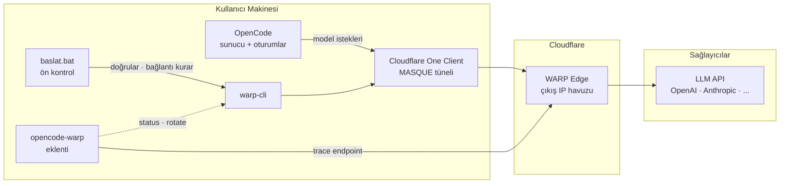

# opencode-warp

> **OpenCode** ile **Cloudflare WARP** arasında köprü: çıkışının her zaman güvenli tünelden
> gittiğini bil, kanıtla ve tek komutla tazele.

[](#)
[](#)
[](#)
[](#lisans)

---

## İçindekiler

- [Bu proje ne işe yarar?](#bu-proje-ne-işe-yarar)
- [Neden ihtiyaç var?](#neden-ihtiyaç-var)
- [Nasıl çalışır?](#nasıl-çalışır)
- [Mimari](#mimari)
- [Kurulum](#kurulum)
- [Kullanım](#kullanım)
- [OpenCode içinden kullanım](#opencode-içinden-kullanım)
- [Ayarlar](#ayarlar)
- [Dosya yapısı](#dosya-yapısı)
- [Tipik senaryolar](#tipik-senaryolar)
- [Teknik detaylar](#teknik-detaylar)
- [Doğrulama](#doğrulama)
- [Sorun giderme](#sorun-giderme)
- [Lisans](#lisans)

---

## Bu proje ne işe yarar?

`opencode-warp`, bir OpenCode eklentisi ve onu çevreleyen küçük bir araç setidir.
Üç net iş yapar:

| # | Yetenek | Sonuç |
| --- | --- | --- |
| 1 | **Çıkış doğrulama** | OpenCode'un hangi IP'den ve hangi ülkeden çıktığını her an görürsün. |
| 2 | **Tek komutla IP tazeleme** | IP'ye bağlı bir kısıtlama hissettiğinde tüneli yeniler, yeni adres alırsın. |
| 3 | **Otomatik koruma** | İsteğe bağlı olarak 429 yanıtlarında IP'yi kendiliğinden döndürür. |

Ek olarak açılış öncesi tek tıkla kontrol sağlayan bir Windows başlatıcısı (`baslat.bat`) ve
OpenCode'u hiç açmadan durum görebileceğin bağımsız bir betik (`dogrula.mjs`) içerir.

**Hedef kitle:** Cloudflare One Client (eski adıyla WARP) kurulu bir makinede OpenCode kullanan,
çıkışının tünelden gittiğinden emin olmak isteyen geliştiriciler.

---

## Neden ihtiyaç var?

Cloudflare One Client **Traffic and DNS** modunda çalıştığında cihazın tüm çıkış trafiği
Cloudflare tünelinden geçer. OpenCode da aynı makinede çalışan bir süreçtir, dolayısıyla
model istekleri de otomatik olarak tünelden çıkar.

Bu kendiliğinden iyi çalışır — ta ki şu sorulara cevap arayana kadar:

- *"Gerçekten tünelden mi çıkıyorum, yoksa sessizce doğrudan mı bağlanıyorum?"*
- *"Hangi IP'yi görüyor sağlayıcı? Ülkem doğru mu?"*
- *"Tünel düştüyse bunu ne zaman fark edeceğim?"*
- *"IP kaynaklı bir kısıtlamada IP'yi tazelemenin en hızlı yolu ne?"*

`curl` ile tek seferlik kontrol yapılabilir, ama bu OpenCode'un kendi süreci hakkında kesin
bilgi vermez; her seferinde elle yapılması gerekir ve oturum ortasında tünelin düşmesi
fark edilmez.

`opencode-warp` tam bu boşluğu doldurur: **doğrulamayı otomatikleştirir, görünür kılar ve
gerektiğinde tek adımda tazeleme sunar.**

---

## Nasıl çalışır?

```
                          ┌──────────────────────────────┐
  OpenCode ─── istek ───▶ │  Cloudflare WARP tüneli      │ ───▶ Sağlayıcı API
  (model çağrıları)       │  (MASQUE · Always On)        │      (OpenAI, Anthropic,
                          └──────────────────────────────┘       OpenRouter, ...)
```

Trafiğin yönlendirilmesi WARP'ın kendi işidir ve zaten doğru çalışır.
`opencode-warp` bu akışın **üzerine üç katman** ekler:

### Katman 1 — Açılış doğrulaması

OpenCode sunucusu ayağa kalktığında eklenti arka planda sessizce:

1. `warp-cli status` ile istemcinin bağlı olup olmadığını okur,
2. `https://www.cloudflare.com/cdn-cgi/trace` üzerinden çıkış IP'sini, ülkeyi, colo'yu ve
   `warp=on/off` alanını alır,
3. sonucu tek satırlık bir karar cümlesine çevirir.

Bu iş **hiçbir isteği bekletmez** — arka planda çalışır, yalnızca log'a yazar.
Herhangi bir uyuşmazlıkta açık bir uyarı bırakır.

### Katman 2 — Sorgulanabilir araçlar

Modele iki araç tanıtılır:

- **`warp_status`** — anlık çıkış durumu (IP, ülke, colo, `warp=on/off`, tünel durumu).
- **`warp_rotate`** — tüneli yeniden kurar, yeni çıkış IP'si almaya çalışır, sonucu raporlar.

Bu araçlar sayesinde model, bir hata aldığında *"acaba IP kaynaklı mı?"* sorusunu
kendisi cevaplayabilir; sana sorması gerekmez.

### Katman 3 — Opsiyonel otomatik tazeleme

`rotateOnRateLimit` açıksa eklenti `retry` kancasına bağlanır ve yalnızca `429` yanıtlarında
devreye girer:

1. Yanıt gövdesi faturalandırma/kota ile ilgiliyse **dokunmaz** (o durumda IP değiştirmek
   yanlış araçtır).
2. Aksi halde cooldown ve saatlik tavanı kontrol eder.
3. Tüneli tazeler, yeni IP'yi bekler, ardından isteği kısa bir gecikmeyle yeniden dener.

Böylece geçici IP kaynaklı kısıtlamalar oturumu kesmeden atlatılır.

---

## Mimari



Eklenti hiçbir zaman veri yolunda **değildir**. İsteklerin gecikmesine girmez, istek gövdesini
değiştirmez, header eklemez. Yalnızca yan gözlemci + kontrol paneli gibi çalışır. Bu bilinçli
bir tasarım tercihidir: hata yüzeyi küçük kalır, OpenCode'un kendi ağ davranışı bozulmaz.

---

## Kurulum

### Gereksinimler

| Bileşen | Sürüm / Not |
| --- | --- |
| Windows | 10 veya 11 |
| OpenCode | v2.x (geliştirme v2.2.5 ile yapıldı) |
| Cloudflare One Client | Kurulu ve hesaba kayıtlı |
| Node.js | 20+ (yalnızca `dogrula.mjs` için) |

Cloudflare tarafında istemci **Traffic and DNS** modunda olmalı:

```bat
warp-cli settings
:: Mode: WarpWithDnsOverHttps  görmelisin
```

### Adım 1 — Depoyu al

```bat
git clone https://github.com/<kullanıcı>/opencode-warp.git
cd opencode-warp
```

### Adım 2 — Bağımlılıkları kur

```bat
npm install
```

### Adım 3 — Başlatıcıyı çalıştır

```bat
baslat.bat
```

Betik şunları yapar:

1. `%USERPROFILE%\.config\opencode\plugins\opencode-warp` konumuna bu klasöre işaret eden bir
   **junction** oluşturur — eklenti böylece global olarak yüklenir, `opencode.json`
   düzenlemene gerek kalmaz.
2. `warp-cli`'ı bulur, sürümünü yazar.
3. Tünel bağlı değilse bağlar.
4. `warp=on` ve çıkış IP'sini doğrular.
5. Her şey yerindeyse **HAZIR** der.

Örnek çıktı:

```
 ============================================================
  OpenCode  x  Cloudflare WARP
 ============================================================

 [1/4] Eklenti baglantisi
       ok - eklenti baglandi: C:\Users\user\.config\opencode\plugins\opencode-warp
 [2/4] warp-cli
       ok - warp-cli 2026.6.880.0
 [3/4] Tunel baglantisi
       ok - zaten bagli
 [4/4] Cikis dogrulamasi
       ok - warp=on
       cikis IP : 2a09:bac5:58c5:d2d::150:d1
       konum    : TR / IST

 ------------------------------------------------------------
  HAZIR - trafik Cloudflare WARP uzerinden cikiyor.
  Simdi OpenCode'u acabilirsin.
 ------------------------------------------------------------
```

### Adım 4 — OpenCode'u aç

Eklenti sunucu tarafından otomatik yüklenir. Doğrulamak için:

```
/warp
```

---

## Kullanım

### Başlatıcı

```bat
baslat.bat                  :: doğrula, hazır bekle
baslat.bat yeni-ip          :: önce IP tazele, sonra doğrula
baslat.bat opencode         :: doğrulamadan sonra OpenCode'u başlat
baslat.bat yeni-ip opencode :: ikisini birleştir
baslat.bat help             :: yardım
```

`baslat.bat` **zorunlu değildir**. WARP zaten bağlıysa OpenCode'u doğrudan açabilirsin.
Betik, "acaba tünelde miyim?" sorusunu otomatikleştirmek isteyenler için vardır.

### Bağımsız doğrulama

```bat
node dogrula.mjs            :: durum göster
node dogrula.mjs --rotate   :: IP tazele + durum göster
```

Çıkış kodu `0` → trafik WARP üzerinden, `1` → değil. Bu sayede CI/CD betiklerine veya
kendi otomasyonuna bağlayabilirsin.

```
Cloudflare WARP cikis durumu
  zaman        : 2026-11-02T11:10:09.149Z
  warp-cli     : Connected
  warp         : on
  cikis IP     : 2a09:bac5:58c5:d2d::150:d1
  konum / colo : TR / IST
  gateway      : off
  sonuc        : OK - trafik Cloudflare WARP uzerinden cikiyor.
```

---

## OpenCode içinden kullanım

### `/warp` komutu

Oturumda çalıştırdığında çıkış durumunu bilgi mesajı olarak bırakır. Modeli çalıştırmaz,
token harcamaz.

```
/warp
```

### `warp_status` aracı

Model çağırabilir veya sen doğrudan isteyebilirsin:

> "warp_status çalıştır, hangi IP'den çıkıyorum?"

Dönen bilgi:

| Alan | Anlamı |
| --- | --- |
| `warp` | `on` / `plus` / `off` — tünelin gerçekten devrede olup olmadığı |
| `çıkış IP` | Sağlayıcıların göreceği adres |
| `konum / colo` | Ülke ve Cloudflare edge lokasyonu |
| `gateway` | Cloudflare Gateway'in devrede olup olmadığı |
| `sonuç` | Tek cümlelik karar |

### `warp_rotate` aracı

Tüneli kapatır, yeniden açar, yeni IP'yi bekler ve raporlar:

```
Yeni WARP çıkış IP'si alındı.
  önce : 2a09:bac5:58c5:d2d::150:d1
  sonra: 2a09:bac5:9f12:4411::150:2a
  deneme: 1
  warp : on
```

Dahili olarak üç deneme yapar, cooldown ve saatlik tavanı uygular. Böylece art arda
tazeleme tüneli yormaz.

---

## Ayarlar

`warp.config.json` dosyasını düzenle:

```jsonc
{
  "verifyOnStart": true,       // açılışta arka planda doğrula
  "logEgress": true,           // sonucu log'a yaz
  "rotateOnRateLimit": false,  // 429'da otomatik tazeleme
  "rotateCooldownMs": 45000,   // iki tazeleme arası minimum süre
  "rotateMaxPerHour": 6,       // saatlik tavan
  "rotateWaitMs": 25000,       // tünelin geri gelmesi için üst süre
  "traceTimeoutMs": 8000,      // trace isteği zaman aşımı
  "cliTimeoutMs": 20000        // warp-cli komut zaman aşımı
}
```

| Anahtar | Varsayılan | Açıklama |
| --- | --- | --- |
| `verifyOnStart` | `true` | Sunucu açılışında sessiz doğrulama |
| `logEgress` | `true` | Doğrulama sonucunu log'a bas |
| `rotateOnRateLimit` | `false` | 429'da IP otomatik tazelensin mi |
| `rotateCooldownMs` | `45000` | Tazelemeler arası bekleme |
| `rotateMaxPerHour` | `6` | Saatlik tazeleme tavanı |
| `rotateWaitMs` | `25000` | Tünel geri gelmezse vazgeçme süresi |
| `traceTimeoutMs` | `8000` | Trace endpoint zaman aşımı |
| `cliTimeoutMs` | `20000` | `warp-cli` komut zaman aşımı |

Ayarı `opencode.json` üzerinden de verebilirsin — dosyadaki değeri geçersiz kılar:

```jsonc
{
  "plugins": [
    {
      "package": "C:/Users/user/Desktop/opencode-warp",
      "options": { "rotateOnRateLimit": true }
    }
  ]
}
```

### `rotateOnRateLimit` açıkken davranış

```
429 gelir
   │
   ├─ gövde billing / quota / credit / balance içeriyor mu? ──▶ evet ──▶ dokunma
   │
   └─ hayır
        │
        ├─ cooldown veya saatlik tavan dolu mu? ──▶ evet ──▶ sadece bekle
        │
        └─ hayır ──▶ tüneli tazele ──▶ yeni IP bekle ──▶ kısa gecikmeyle yeniden dene
```

Bu ayrım önemli: IP değiştirmek **IP/ülke kaynaklı** kısıtlamalarda doğru araçtır.
Eklenti, faturalandırma kaynaklı yanıtlarda gereksiz tazeleme yapmaz.

---

## Dosya yapısı

```
opencode-warp/
├─ index.js            Eklentinin tamamı (araçlar, komut, kancalar, doğrulama)
├─ warp.config.json    Varsayılan ayarlar
├─ baslat.bat          Windows ön kontrol başlatıcısı
├─ dogrula.mjs         OpenCode'suz doğrulama / tazeleme
├─ package.json        Manifest
├─ README.md           Bu dosya
└─ .gitignore
```

Eklenti tek dosyada toplanmıştır: `index.js`. Harici çalışma zamanı bağımlılığı yoktur
(`@opencode/plugin` dışında), bu da kurulumu ve denetimi kolaylaştırır.

---

## Tipik senaryolar

### Senaryo 1 — Sabah ilk açılış

```bat
baslat.bat
```

Tünel bağlanır, `warp=on` doğrulanır, HAZIR mesajı gelir. OpenCode'u açarsın.
Arka planda eklenti bir kez daha doğrular ve log'a yazar.

### Senaryo 2 — Uzun oturum, tünel düştü

Model bir bağlantı hatası verdi. `/warp` çalıştırırsın:

```
warp-cli     : Disconnected
warp         : off
sonuç        : PROBLEM - trafik tünelsiz çıkıyor.
```

Sorunun ağ olduğunu saniyeler içinde görürsün, modeli/anahtarı suçlamaya başlamazsın.

### Senaryo 3 — IP kaynaklı kısıtlama

`warp_rotate` çalıştırırsın. Tünel tazelenir, yeni IP gelir, aynı isteği tekrar denersin.

### Senaryo 4 — Hiç uğraşmadan otomatik

`rotateOnRateLimit: true` yaparsın. Bundan sonra geçici IP kaynaklı 429'lar oturumu
kesmeden, eklenti tarafından sessizce atlatılır.

### Senaryo 5 — Betik/otomasyon

```bat
node dogrula.mjs || echo "WARP yok, islem iptal"
```

Çıkış kodu sayesinde kendi CI adımına, deploy betiğine veya zamanlanmış göreve
kolayca bağlarsın.

---

## Teknik detaylar

### Eklenti API'si

Eklenti OpenCode V2 plugin API'sini kullanır:

| API | Kullanım |
| --- | --- |
| `ctx.tool.transform` | `warp_status` / `warp_rotate` araçlarını kaydeder |
| `ctx.command.transform` | `/warp` komutunu kaydeder |
| `ctx.session.hook("retry")` | 429 tazeleme politikası |
| `ctx.session.synthetic` | Komut çıktısını oturuma bilgi mesajı olarak yazar |
| `ctx.options` | `opencode.json` üzerinden gelen ayarlar |

Tüm kayıtlar `setup` içinde yapılır ve dönen temizlik fonksiyonuyla düzgün şekilde
bırakılır — eklenti yeniden yüklendiğinde kayıt sızıntısı olmaz.

### Neden istek yolunda değil?

OpenCode V2 hook'ları (`http.request`, `model.request`, `experimental.ws.handshake`)
header, gövde ve URL değiştirebilir; ancak bağlantının hangi soketten çıkacağını seçmez.
Trafiği bir proxy'ye yönlendirmenin desteklenen yolu ortam değişkenleridir:

```bat
opencode service set env HTTPS_PROXY http://127.0.0.1:40000
opencode service set env NO_PROXY localhost,127.0.0.1,::1
```

Aynı makinede tam tünel modu aktifken buna gerek yoktur — WARP cihazın tüm çıkışını zaten
yönetir. Eklentinin bunun yerine doğrulama ve tazeleme yapması bilinçli bir tercihtir:
veri yoluna girmez, gecikme eklemez, OpenCode'un ağ davranışını değiştirmez.

### Güvenlik notları

- Eklenti hiçbir kimlik bilgisini okumaz, saklamaz veya iletmez.
- Trace endpoint'i yalnızca genel çıkış bilgisi döndürür; istek gövdesi veya header gönderilmez.
- `warp-cli` yalnızca `status`, `connect`, `disconnect` alt komutlarıyla çağrılır.
- Ağ erişimi olmayan ortamlarda tüm işlemler sessizce `UNKNOWN` durumuna düşer;
  OpenCode'un çalışmasını engellemez.

---

## Doğrulama

Kurulum sonrası hızlı sağlık kontrolü:

```bat
warp-cli status                     :: Connected
warp-cli settings                   :: Mode: WarpWithDnsOverHttps
warp-cli tunnel host list           :: boş (alan adı istisnası yok)
node dogrula.mjs                    :: warp=on + IP
opencode api get /api/info          :: CLI <-> servis loopback sağlıklı
```

Bu proje geliştirilirken şu senaryolar gerçek makinede test edildi:

| Test | Beklenen | Sonuç |
| --- | --- | --- |
| Eklenti yüklenmesi | Araç ve komut kaydı | ✅ `warp` namespace + `/warp` komutu göründü |
| `warp_status` | IP + ülke + `warp=on` | ✅ doğru değerler döndü |
| Tünel kapalıyken | `warp=off` + uyarı | ✅ yanlış "OK" vermedi |
| `baslat.bat` (kapalı tünel) | Bağlan + doğrula | ✅ HAZIR mesajı |
| `baslat.bat` (açık tünel) | Yeniden bağlanmadan doğrula | ✅ "zaten bağlı" |
| `dogrula.mjs` çıkış kodu | `0` | ✅ |
| `baslat.bat help` | Yardım metni | ✅ |

---

## Sorun giderme

| Belirti | Kontrol |
| --- | --- |
| `warp=off` | `warp-cli status` — bağlı mı? `warp-cli connect` |
| Yanlış ülke görünüyor | `warp-cli settings` — mod doğru mu |
| Eklenti görünmüyor | `%USERPROFILE%\.config\opencode\plugins\opencode-warp` var mı |
| Araçlar listede yok | `opencode service restart`, sonra `/reload` |
| IP değişmiyor | `warp-cli connect` tekrarı; aynı colo havuzundan aynı adres gelebilir |
| Uzun yanıtlar kopuyor | Modun `WarpWithDnsOverHttps` olduğundan emin ol |

### Junction'ı kaldırma

```bat
rmdir "%USERPROFILE%\.config\opencode\plugins\opencode-warp"
```

Klasörü taşırsan junction eski yolu gösterir; silip `baslat.bat`'ı yeniden çalıştır.

### Log'a bakma

Doğrulama sonuçları OpenCode log'una `[warp]` etiketiyle yazılır:

```bat
Select-String -Path "$env:USERPROFILE\.local\share\opencode\log\opencode.log" -Pattern "\[warp\]"
```

---

## Yol haritası

- [x] Açılış doğrulaması ve log'lama
- [x] `warp_status` / `warp_rotate` araçları
- [x] `/warp` komutu
- [x] 429 üzerine opsiyonel otomatik tazeleme
- [x] Windows başlatıcısı ve bağımsız doğrulama betiği
- [ ] macOS / Linux başlatıcı eşdeğeri
- [ ] Çoklu profil desteği (farklı WARP hesapları arasında geçiş)
- [ ] Colo bazlı tercih (belirli edge lokasyonuna yönlendirme)

---

## Lisans

MIT. Ayrıntılar için `LICENSE` dosyasına bak.

---

<p align="center">
  <sub>Cloudflare WARP + OpenCode · çıkışını bil, kanıtla, tazele.</sub>
</p>
